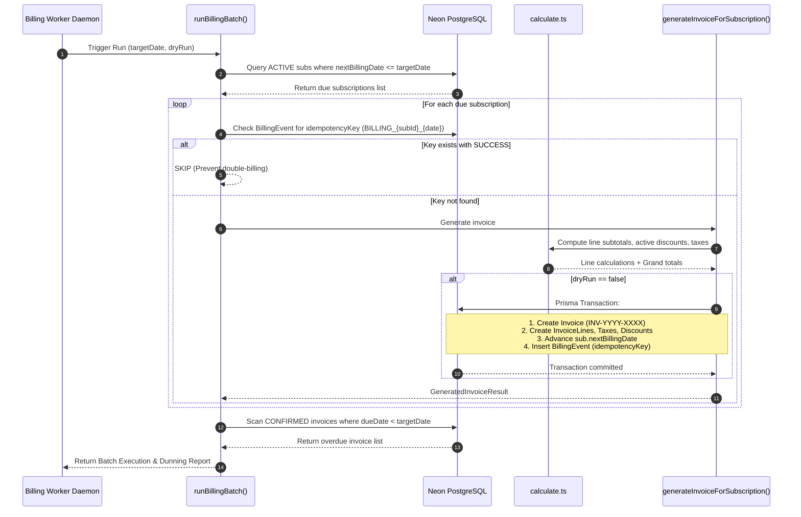
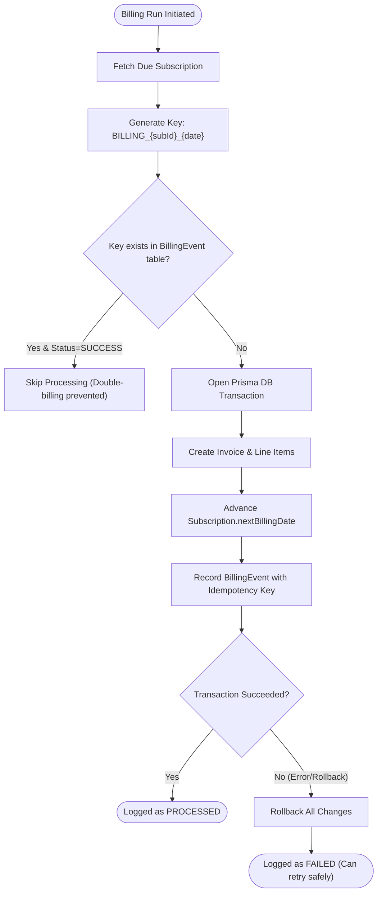

# Brightloop Automated Recurring Billing Engine & Worker Architecture

## 1. Executive Summary & Core Concept

In modern SaaS and enterprise subscription software (e.g. Odoo, Stripe Billing, Chargebee), recurring revenue cannot rely on manual administrative intervention. Invoicing must be **predictable, legally compliant, financially exact, and crash-resilient**.

The **Brightloop Billing Engine** is an automated, idempotent pipeline designed according to the [Subscription Management System specification](./Subscription_Management_System.pdf). It automates the recurring lifecycle of subscriptions:
1. Detecting due subscriptions based on recurrence schedules (`monthly`, `yearly`, `quarterly`, `weekly`).
2. Calculating multi-line totals, jurisdictional taxes (18% GST), and rule-based discounts (minimum seats, spend limits, date windows, coupon limits).
3. Minting official sequential tax invoices (`INV-YYYY-XXXX`).
4. Advancing the subscription's `nextBillingDate` into the future.
5. Guaranteeing **Zero Double-Billing** via transactional idempotency keys.
6. Scanning and flagging delinquent/overdue accounts for automated chasing (dunning).

---

## 2. High-Level Architecture & Lifecycle



---

## 3. Component Deep Dive

### A. Pure Functional Math Engine (`src/modules/billing/calculate.ts`)
The calculation engine is isolated from database side-effects, making it 100% deterministic and unit-testable.

```
Line Subtotal = Unit Price × Quantity
Line Discount = (Subtotal × Percentage) OR Fixed Amount
Tax Base      = Subtotal - Discount
Line Tax      = Tax Base × (Tax Rate ÷ 100)
Line Total    = Tax Base + Line Tax
```

#### Multi-Tier Discount Evaluation:
Before a discount code is applied, the engine validates 5 strict gating rules:
- **Active Window**: `validFrom <= today <= validUntil`
- **Minimum Seat Threshold**: `subscription.totalSeats >= discount.minSeats`
- **Minimum Spend Limit**: `subtotal >= discount.minAmount`
- **Max Usage Count**: `currentUsage < discount.maxRedemptions`
- **Status**: `isActive === true`

---

### B. Sequential Invoice Generation (`src/modules/billing/generate-invoice.ts`)
Responsible for transforming active subscription line items into a legal tax invoice record:

1. **Sequential Invoice Numbering**:
   - Queries the latest invoice for the current calendar year.
   - Generates collision-resistant numbers: `INV-2026-0001`, `INV-2026-0002`, etc.
2. **Line Item & Tax Snapshotting**:
   - Copies description, quantity, unit price, tax rate, and discounts at the exact moment of billing. Future catalog price changes do not retroactively alter issued invoices.
3. **Idempotency Locking**:
   - Generates a unique key: `BILLING_{subscriptionId}_{YYYY-MM-DD}`.
   - Written within the same database transaction. Any repeated execution on the same date will skip processing without creating duplicate invoices.
4. **Subscription Period Advancement**:
   - Computes the next billing date based on recurrence:
     - `DAILY` -> `+1 day`
     - `WEEKLY` -> `+7 days`
     - `MONTHLY` -> `+1 month` (or `+N months` according to interval count)
     - `YEARLY` -> `+1 year`
5. **Auto-Close Policy Handling**:
   - If `autoClose === true` and the subscription has reached its `endDate`, the status transitions from `ACTIVE` to `CLOSED`.

---

### C. Batch Orchestration & Overdue Scanning (`src/modules/billing/run-billing.ts`)
The orchestrator executes the complete daily billing run:

1. **Active Due Subscription Scanner**:
   - Queries `Subscription` where `status = "ACTIVE"` and `nextBillingDate <= targetDate`.
2. **Safe Batch Processor**:
   - Iterates through subscriptions with error boundaries. If one customer's billing fails (e.g. invalid tax configuration), it logs the failure and continues processing remaining customers without crashing the batch.
3. **Overdue Dunning Detection**:
   - Scans for all invoices where `status = "CONFIRMED"` and `dueDate < targetDate`.
   - Computes `daysOverdue = floor((targetDate - dueDate) / 86400000)`.
   - Compiles a list of overdue invoices with customer contact info for the accounts receivable team.

---

### D. Standalone CLI & Daemon Runner (`scripts/billing-worker-runner.mjs`)
A lightweight, zero-dependency Node.js script that can run standalone on host machines, via OS crontabs, or systemd services.

#### Supported Flags:
| Flag | Description | Example |
|---|---|---|
| `--dry-run` | Simulates calculation and invoice generation without writing to the database | `node scripts/billing-worker-runner.mjs --dry-run` |
| `--date=YYYY-MM-DD` | Simulates a specific target date (useful for retroactive runs or testing) | `node scripts/billing-worker-runner.mjs --date=2026-11-01` |
| `--daemon` | Keeps the worker running continuously in the background | `node scripts/billing-worker-runner.mjs --daemon` |
| `--interval=M` | Interval between billing checks in daemon mode (minutes, default: 60) | `npm run worker:billing -- --daemon --interval=30` |

---

### E. Web API Trigger (`src/app/api/billing/run/route.ts`)
Exposes a secure endpoint for administrators to trigger the billing batch on-demand from the browser UI or external webhooks:
- **Endpoint**: `POST /api/billing/run`
- **Payload**:
  ```json
  {
    "dryRun": false,
    "targetDate": "2026-10-31"
  }
  ```
- **Response**: Full summary report with counts, generated invoice IDs, skipped items, and overdue dunning list.

---

## 4. Idempotency & Fault Tolerance



### Why Idempotency Matters:
1. **Worker Crashes**: If the server reboots halfway through a batch of 1,000 subscriptions, restarting the worker will skip the 450 already billed and seamlessly pick up at subscription 451.
2. **Network Retries**: If an API trigger is double-clicked or sent twice by an automated cron, the second call returns `SKIPPED` with zero duplicate financial records.
3. **Auditing**: Every run writes an immutable log in the `BillingEvent` table with execution timestamp, status, and linked invoice ID.

---

## 5. How to Run & Verify

### One-Time Live Run
```bash
cd frontend
node scripts/billing-worker-runner.mjs
```

### Preview Run (Dry Run)
```bash
cd frontend
node scripts/billing-worker-runner.mjs --dry-run
```

### Continuous Background Daemon (Production)
```bash
cd frontend
npm run worker:billing -- --daemon --interval=60
```
*(Monitors every 60 minutes, bills subscriptions the moment their billing date arrives, and surfaces overdue chasing alerts).*

